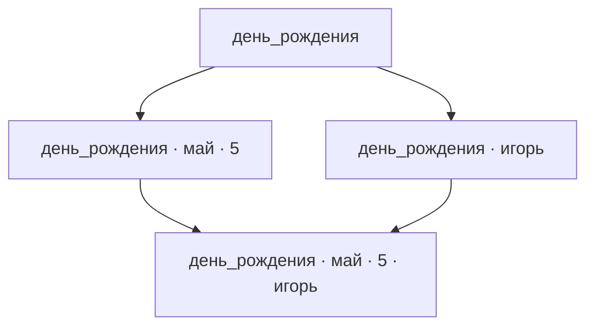

# Иерархия теговых узлов: концепция продукта

Ментальная модель продукта использует аналогию с папками и файлами. Узлы иерархии определяются наборами тегов и образуют направленный ациклический граф (DAG).

## 1. Назначение продукта

Продукт помогает быстро получать выборки элементов по набору тегов.

Главный принцип представления — в каждый момент времени показывать пользователю по возможности наиболее обозримый результат из элементов, максимально релевантных текущему узлу иерархии.

Рабочая область содержит элементы разных типов: тексты, изображения, аудиозаписи, видеозаписи и другие. Пользователь получает нужные элементы, задавая теги, и исследует рабочую область через переходы к соседним заполненным узлам графа.

## 2. Базовая функциональность и расширения

### Базовая функциональность

| Направление | Возможности |
| --- | --- |
| Рабочие области | Работа с элементами разных типов и фиксированной версией глоссария, созданного или выбранного пользователем либо заданного по умолчанию. |
| Наполнение и разметка | Постепенное добавление элементов, быстрое сохранение без разметки, ручная разметка и переразметка. Отдельный список неразмеченных элементов, возобновляемая разметка и визуальное обозначение её прогресса. |
| Редактирование и удаление | Редактирование содержания, помощь в поддержании его соответствия тегам и окончательное удаление элементов из рабочей области. |
| Теговые выборки | Быстрый отбор элементов по всем выбранным тегам и автодополнение при вводе тегов. |
| Навигация | Сужение и расширение выборки добавлением и удалением тегов, переходы к соседним заполненным узлам с приоритетом по близости. Представление графом или набором переходов, история назад и вперёд, выход в корень одним действием. |
| Просмотр | При открытии узла — его собственные элементы и переходы к соседним заполненным узлам-потомкам. Возможность просмотра полной теговой выборки с выделением собственных элементов. Сортировка только по времени последнего изменения, по умолчанию — недавно изменившиеся первыми. |
| Перенос данных | Импорт и экспорт всей рабочей области или её части с глоссарием и без него; выбор полного или сокращённого глоссария при частичном экспорте. Распознавание повторного импорта и переразметка по правилам принимающей рабочей области. |

Эволюция глоссария и переходы через замену тегов в базовую функциональность не входят.

### Необязательные расширения

- **Автоматическая разметка с помощью LLM** — назначение тегов в фоновом режиме, в том числе при добавлении и переразметке импортированных элементов.
- **Поиск по тексту внутри текущей выборки** — поиск по словам содержания записей, в том числе по словам, которые не являются тегами.

## 3. Элементы, содержание и теги

При экспорте, импорте и изменении теговой разметки элемент считается тем же. При изменении содержания результат считается другим элементом и заменяет исходную запись в рабочей области. Продукт должен распознавать повторный импорт того же элемента.

У элемента есть теговая разметка и отдельное от неё содержание. Теговая разметка — полный набор тегов, назначенных элементу в данной рабочей области. В базовой функциональности теги назначаются пользователем вручную; расширение автоматической разметки позволяет назначать их с помощью LLM.

За соответствие тегов содержанию отвечает тот, кто изменяет содержание или разметку: пользователь либо LLM.

При редактировании содержания пользователь видит текущие теги. При изменении тегов ему доступно содержание элемента для чтения, просмотра или воспроизведения.

Перед сохранением изменённого содержания продукт напоминает пользователю, что теги должны соответствовать новому содержанию. Напоминание включено по умолчанию и может быть отключено в настройках.

Разметка каждого отдельного элемента **атомарна**.

Содержание может быть пустым. Например, запись с тегами `игорь артемьев май день_рождения 5` может иметь пустое содержание. Теги позволяют понять, о каком факте идёт речь, и остаются тегами, отдельными от содержания записи.

Текстовые элементы должны быть обозримыми: обычно не более одного абзаца, максимум несколько абзацев. Примеры таких элементов — анекдоты, афоризмы, тосты, стихи и заметки разного характера.

Используемые теги задаются глоссарием. Пользователь создаёт глоссарий, выбирает существующий или использует глоссарий по умолчанию. Рабочая область использует фиксированную версию глоссария.

Продукт различает версии глоссариев и распознаёт одну и ту же версию в разных рабочих областях.

## 4. Узлы и выборки

Каждый набор тегов определяет узел модели и соответствующую ему **теговую выборку**. Выборка включает все размеченные элементы, которым назначены все эти теги; у элементов могут быть дополнительные теги.

**Размеченным элементом** считается элемент с завершённой разметкой по глоссарию данной рабочей области. Уже размеченные элементы участвуют в выборках независимо от готовности остальных. Ещё неразмеченные элементы в выборках не участвуют.

Узлы различаются по задающим их тегам. Два разных узла могут иметь одинаковые по составу выборки.

Пользователь выбирает теги для отбора элементов. Узел с этим набором тегов называется текущим, а его выборка — текущей.

**Корень (корневой узел)** — узел с пустым набором тегов. Его выборка включает все размеченные элементы рабочей области.

Разметку элемента можно завершить с пустым набором тегов. Такой элемент является собственным элементом корня.

При первом открытии рабочей области текущим становится корень. При повторном открытии восстанавливается последний посещённый узел.

Из любого узла пользователь может перейти в корень одним действием — например, нажатием отдельной кнопки. При таком переходе снимаются все выбранные теги.

При изменении выбранных тегов:

- Добавление тегов сужает выборку.
- Удаление тегов расширяет выборку.

Например, при просмотре полной теговой выборки пользователь вводит имя знакомого и получает записи, которым назначен этот тег. Если записей слишком много, он добавляет фамилию и ищет среди оставшихся запись о дне рождения. Обратный сценарий — задать дату и найти записи о людях, у которых на неё приходится день рождения.

## 5. Собственные элементы и заполненность узла

**Собственными элементами узла** называются размеченные элементы, теговая разметка которых полностью совпадает с набором тегов узла. Выражение «элемент принадлежит узлу» обозначает это точное совпадение.

В каждой рабочей области размеченный элемент принадлежит ровно одному узлу. При этом он может входить в выборки нескольких узлов.

**Заполненный узел** имеет хотя бы один собственный элемент. Наличие содержания у этого элемента не требуется: запись с пустым содержанием также заполняет узел.

**Выборка узла** включает его собственные элементы и собственные элементы всех потомков — узлов, чьи наборы тегов строго включают набор тегов исходного узла.

Таким образом, у узла может не быть собственных элементов, хотя его выборка непуста за счёт потомков.

Например, пусть существует только одна запись с разметкой `день_рождения май 5`:

| Узел | Собственные элементы | Выборка |
| --- | --- | --- |
| `день_рождения` | Нет | Содержит запись |
| `день_рождения май` | Нет | Содержит запись |
| `день_рождения май 5` | Эта запись | Содержит запись |

В этом примере заполнен только последний узел, а выборки всех трёх узлов непусты.

### Просмотр узла

При открытии узла пользователь видит его собственные элементы и соседние заполненные узлы-потомки, доступные для перехода. Собственные элементы соответствуют файлам в открытой папке, а переходы к потомкам — подпапкам. Для просмотра собственных элементов потомка пользователь открывает соответствующий узел.

Пользователь может переключаться между этим представлением и просмотром полной теговой выборки, не меняя выбранных тегов. В полной выборке собственные элементы текущего узла должны визуально выделяться среди элементов потомков.

Элементы сортируются по времени последнего изменения. Для нового элемента это время его добавления в рабочую область. Изменение теговой разметки, включая фоновую разметку LLM, обновляет это время. По умолчанию сначала показываются наиболее недавно изменившиеся элементы.

## 6. Модель DAG

Структура модели задаётся включением наборов тегов. Если набор тегов одного узла строго входит в набор другого, выборка первого включает выборку второго. Направление рёбер фиксирует добавление тегов, то есть сужение выборки.

### DAG всех наборов тегов

В этой модели каждому набору тегов из глоссария соответствует узел. Ребро соответствует добавлению одного тега.

Цикл невозможен: движение по направлению рёбер каждый раз увеличивает набор тегов. У одного узла может быть несколько предшественников и несколько потомков.

### Граф соседства заполненных узлов

Граф соседства заполненных узлов состоит из заполненных узлов. Ребро направлено от меньшего набора тегов к большему и связывает узлы, между которыми нет других заполненных узлов. Такое представление порядка называется диаграммой Хассе.

Промежуточный узел имеет все теги меньшего набора и непустую часть дополнительных тегов большего набора, но не все эти дополнительные теги. При определении соседних заполненных узлов учитываются все такие промежуточные узлы.

Одно ребро графа соседства заполненных узлов может соответствовать добавлению нескольких тегов. Поэтому число рёбер и число изменяемых тегов — разные величины. При переходе от DAG всех наборов тегов связи между заполненными узлами определяются заново.

Например, пусть заполнены только четыре следующих узла:

Узлы `день_рождения май 5` и `день_рождения` — соседние заполненные узлы, хотя переход добавляет два тега. К узлу с четырьмя тегами ведут два направления.

Текущий узел пользователя может не иметь собственных элементов. Для определения соседних заполненных узлов он дополнительно рассматривается вместе с заполненными узлами. Соседними заполненными узлами для него становятся заполненные предки и потомки, между которыми и текущим узлом нет других заполненных узлов.

## 7. Навигация и виды близости

Пользователь видит соседние заполненные узлы, доступные для перехода. **Переход к узлу** делает его текущим: выбранные теги, выборка и предлагаемые направления навигации обновляются в соответствии с этим узлом.

Переход по графу изменяет набор тегов одним из двух способов: добавляет теги при сужении выборки либо удаляет теги при расширении.

Различаются три понятия близости:

| Понятие | Определение |
| --- | --- |
| Соседние узлы | Один узел получается из другого добавлением или удалением одного тега. Заполненность не обязательна. |
| Ближайшие заполненные узлы | Другие заполненные узлы, для достижения которых нужно изменить минимальное число тегов среди допустимых переходов. |
| Соседние заполненные узлы | Заполненные предки и потомки текущего узла, между которыми и текущим нет других заполненных узлов. |

Навигационный приоритет заполненных узлов соответствует их близости к текущему узлу: **чем меньше тегов нужно добавить или удалить для перехода, тем выше приоритет**. Наибольший приоритет имеют ближайшие заполненные узлы.

Переход к соседнему заполненному узлу может требовать добавления или удаления нескольких тегов. Например, если для перехода к одному заполненному узлу нужно добавить два тега, а к другому — четыре, оба являются соседними заполненными узлами для текущего при отсутствии заполненных промежуточных узлов. Первый имеет более высокий навигационный приоритет, чем второй.

Пользователь может двигаться по рёбрам в обе стороны: по их направлению — сужая выборку, против их направления — расширяя её. Направленность DAG не ограничивает доступные направления навигации.

### Симметрия направлений

В дереве у узла один родитель, кроме корня, а дочерних узлов может быть несколько. В DAG у узла могут быть несколько родителей и несколько дочерних узлов. Из разных родительских узлов можно открыть один и тот же узел с одними и теми же собственными элементами.

В навигации по заполненным узлам направления «вверх» ведут к соседним заполненным предкам, направления «вниз» — к соседним заполненным потомкам. В обоих направлениях переход может изменять несколько тегов.

Симметрия направлений используется там, где она помогает пользователю ориентироваться и получать обозримый, релевантный результат. Способы представления предков и потомков выбираются по их полезности для пользователя.

### Обозначения узла и переходов

Текущий узел обозначается полным набором тегов. Переходы к соседним заполненным узлам обозначаются изменением этого набора: знаком `+` и добавляемыми тегами либо знаком `−` и удаляемыми тегами. В обозначении перечисляются все изменяемые при переходе теги.

Например, из узла `ремонт кухня`:

| Узел назначения | Обозначение перехода |
| --- | --- |
| `ремонт кухня электрика` | `+ электрика` |
| `ремонт` | `− кухня` |
| `кухня` | `− ремонт` |

### Представления навигации

Пользователь может переключаться между двумя представлениями:

- **Фрагмент графа** — текущий узел и соседние заполненные узлы с изображением связей между ними.
- **Набор доступных переходов** — варианты сужения и расширения выборки без изображения рёбер.

В обоих представлениях действуют общие правила навигационного приоритета по близости и отображения сведений о количестве элементов.

### Сведения об узлах

При представлении соседних заполненных узлов общее количество элементов выборки учитывается всегда. Количество собственных элементов узла учитывается в зависимости от настроек пользователя.

Эти показатели могут передаваться числами или визуальными признаками — например, размером шрифта, интенсивностью цвета или сочетанием этих способов. Числовое отображение не обязательно.

### История переходов

Продукт поддерживает навигацию назад и вперёд по истории посещённых узлов, аналогично истории веб-браузера. В историю входят переходы как при изменении выбранных тегов, так и при выборе предлагаемых узлов.

- **Назад** — переход к предыдущему узлу в истории.
- **Вперёд** — переход к следующему узлу в истории после возврата назад.

Переход по истории делает соответствующий узел текущим. Направления «назад» и «вперёд» определяются порядком посещений: каждое из этих действий может как сужать, так и расширять выборку.

Если после возврата назад пользователь совершает новый переход, изменяя выбранные теги или выбирая предлагаемый узел, прежнее продолжение истории заменяется этим переходом. Движение назад и вперёд по самой истории новых записей в неё не добавляет.

## 8. Помощь при вводе тегов

Автодополнение работает по мере набора, начиная с первого тега. Оно также помогает выбирать каждый следующий тег.

После выбора тегов подсказки для следующего ограничиваются тегами, встречающимися в элементах текущей выборки. Выбор такого тега сохраняет непустой результат.

Помощь при вводе тегов и навигация по соседним заполненным узлам входят в основной сценарий работы с рабочей областью.

## 9. Наполнение, экспорт и импорт

В типовом сценарии пользователь постепенно наполняет рабочую область, добавляя запись за записью.

При создании нового элемента теги текущего узла автоматически предлагаются в качестве начальной разметки. Пользователь может оставить их, дополнить или изменить.

Пользователь может быстро сохранить новый элемент без разметки. Элемент попадает в список неразмеченных, где его можно разметить вручную или, при использовании расширения автоматической разметки, с помощью LLM в фоновом режиме.

Продукт должен поддерживать четыре варианта экспорта и импорта:

| Объём переноса | Глоссарий в переносимых данных |
| --- | --- |
| Вся рабочая область | С глоссарием |
| Вся рабочая область | Без глоссария |
| Часть рабочей области | С глоссарием |
| Часть рабочей области | Без глоссария |

Частичный перенос включает экспорт и импорт отдельной выборки.

При экспорте части рабочей области с глоссарием пользователь выбирает его состав:

- **Полный глоссарий** — все теги рабочей области, независимо от их использования в экспортируемых элементах.
- **Сокращённый глоссарий** — только теги, использованные в экспортируемых элементах.

При переносе глоссария без изменений его версия сохраняется. Сокращение создаёт самостоятельный глоссарий, отличный от полного исходного.

При экспорте без глоссария теговая разметка элементов сохраняется в экспортируемых данных.

### Переразметка при импорте

Правила переразметки применяются как при импорте всей рабочей области, так и при импорте её части.

При повторном импорте уже размеченного элемента сохраняется разметка принимающей рабочей области. Это правило действует при переносе с любой версией глоссария и без глоссария. Разметка из импортируемых данных её не заменяет и не дополняет.

Повторный импорт уже имеющегося неразмеченного элемента пропускается. Элемент сохраняет своё состояние и остаётся в списке неразмеченных; работа с ним продолжается в режиме разметки.

К элементам, которых ещё нет в принимающей рабочей области, применяются следующие правила:

| Условия импорта | Переразметка элементов |
| --- | --- |
| С той же версией глоссария | По желанию пользователя: сохранить исходную разметку или выполнить переразметку. |
| С другой версией глоссария | Обязательна для всех новых элементов. |
| Без глоссария | Обязательна для всех новых элементов. |

Правила импорта не должны требовать отслеживания цепочки эволюции глоссариев. При импорте с сокращённым глоссарием в рабочую область с полным исходным глоссарием переразметка всех новых для принимающей области элементов обязательна.

Переразметка выполняется тегами глоссария принимающей рабочей области.

Переразметка набора импортируемых элементов может продолжаться длительное время. Продукт должен поддерживать **возобновляемую разметку** — разметку, которую можно приостановить и продолжить позже с сохранением выполненной работы.

## 10. Режим разметки

Неразмеченные элементы доступны в отдельном списке независимо от текущей выборки. Работа с ними выполняется в отдельном режиме разметки:

- **Ручном** — элементы размечает пользователь; входит в базовую функциональность.
- **Фоновом** — элементы размечает LLM; доступен при использовании расширения автоматической разметки.

Прогресс процесса разметки должен обозначаться визуально в обоих режимах.

Доступность и отображение исходной теговой разметки во время переразметки определяются настройками. После завершения переразметки каждого элемента его исходная разметка не сохраняется.

## 11. Открытые вопросы

- Как может развиваться глоссарий тегов?
- Какие правила могут определять переходы через замену тегов, в том числе к узлам с тем же числом тегов?

Подробные определения приведены в [глоссарии проекта](GLOSSARY.md).
