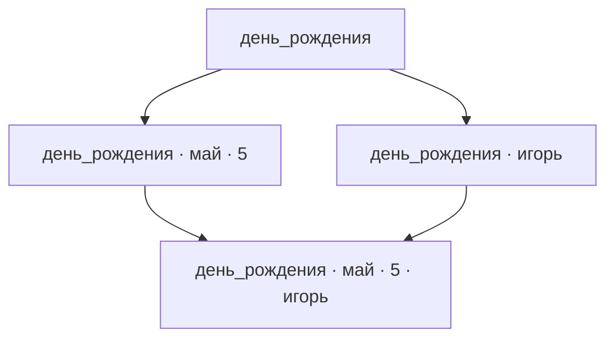

# Идея продукта

## 1. Назначение продукта

Продукт помогает быстро находить нужные записи — тексты, изображения, аудиозаписи, видеозаписи и другие материалы. Такие записи называются **элементами**.

Для отбора элементов используются **теги** — обозначения, назначаемые элементам. Пользователь выбирает нужные теги при поиске.

Главный принцип представления — в каждый момент времени показывать пользователю по возможности наиболее обозримый результат из элементов, максимально релевантных выбранным пользователем тегам.

## 2. Элементы, теги и рабочая область

**Глоссарий тегов** задаёт набор используемых тегов. Пользователь создаёт глоссарий, выбирает существующий или использует глоссарий по умолчанию.

**Рабочая область** — совокупность элементов, организованных с помощью тегов из глоссария.

**Содержание элемента** — текст, изображение, аудиозапись, видеозапись или другое содержимое, отдельное от тегов элемента.

**Теговая разметка элемента** — полный набор тегов, назначенных элементу в данной рабочей области. **Разметка** — назначение элементу тегов из глоссария рабочей области.

**Базовая функциональность** — обязательный набор возможностей продукта. **Необязательные расширения** дополняют этот набор.

В базовую функциональность входит **динамическое создание глоссария**: пользователь может начать с пустого или небольшого глоссария и добавлять новые теги прямо при разметке элементов. Созданный тег включается в глоссарий рабочей области и становится доступным для назначения элементам. Добавление нового тега создаёт другой глоссарий по отношению к исходному. Этот сценарий особенно полезен в начале работы с продуктом.

В базовой функциональности теги назначаются пользователем вручную.

Элемент может иметь необязательное **название**, отдельное от содержания и теговой разметки. Название помогает пользователю узнать элемент при просмотре. Разные элементы могут иметь одинаковые названия, в том числе при одинаковой теговой разметке.

При изменении названия или теговой разметки элемент считается тем же, если содержание не меняется. При изменении содержания результат считается другим элементом и заменяет исходную запись в рабочей области.

Содержание может быть пустым. Например, запись с тегами `игорь артемьев май день_рождения 5` может иметь пустое содержание. Теги позволяют понять, о каком факте идёт речь, и остаются тегами, отдельными от содержания записи.

Текстовые элементы должны быть обозримыми: обычно не более одного абзаца, максимум несколько абзацев. Примеры таких элементов — анекдоты, афоризмы, тосты, стихи и заметки разного характера.

Типовые аудио- и видеоэлементы — песни, ролики и рассказанные анекдоты. Их продолжительность, как правило, не превышает пяти минут.

Разметка каждого отдельного элемента **атомарна**: она выполняется как единое неделимое действие.

**Размеченным элементом** считается элемент с завершённой разметкой по глоссарию данной рабочей области. **Неразмеченный элемент** — элемент, разметка которого ещё не завершена.

Разметку элемента можно завершить с пустым набором тегов.

## 3. Узлы и выборки

**Теговая выборка** — совокупность всех размеченных элементов рабочей области, которым назначены все теги выбранного набора. У элементов могут быть дополнительные теги.

Уже размеченные элементы участвуют в выборках независимо от готовности остальных. Ещё неразмеченные элементы в выборках не участвуют.

**Узел** определяется уникальным набором тегов из глоссария. Соответствующая этому набору теговая выборка называется **выборкой узла**, или **полной теговой выборкой**.

Узлы различаются по задающим их тегам. Два разных узла могут иметь одинаковые по составу выборки.

Пользователь может выбрать любой набор тегов из глоссария для отбора элементов. Эти теги называются **выбранными тегами**, узел с этим набором — **текущим узлом**, а его выборка — **текущей выборкой**.

**Собственными элементами узла** называются размеченные элементы, теговая разметка которых полностью совпадает с набором тегов узла. Выражение «элемент принадлежит узлу» обозначает это точное совпадение.

В каждой рабочей области размеченный элемент принадлежит ровно одному узлу. При этом он может входить в выборки нескольких узлов.

**Заполненный узел** имеет хотя бы один собственный элемент. Наличие содержания у этого элемента не требуется: запись с пустым содержанием также заполняет узел.

**Незаполненный узел** не имеет собственных элементов. **Непустая выборка** содержит хотя бы один элемент.

**Корень (корневой узел)** — узел с пустым набором тегов. Его выборка включает все размеченные элементы рабочей области.

Элемент с завершённой разметкой и пустым набором тегов является собственным элементом корня.

При изменении выбранных тегов:

- Добавление тегов сужает выборку.
- Удаление тегов расширяет выборку.

Например, пусть существует только одна запись с разметкой `день_рождения май 5`:

| Узел | Собственные элементы | Выборка |
| --- | --- | --- |
| `день_рождения` | Нет | Содержит запись |
| `день_рождения май` | Нет | Содержит запись |
| `день_рождения май 5` | Эта запись | Содержит запись |

В этом примере заполнен только последний узел, а выборки всех трёх узлов непусты.

## 4. Иерархия и связи между узлами

Узлы образуют иерархию по включению наборов тегов.

**Потомок узла** имеет все теги исходного узла и хотя бы один дополнительный тег. **Предок узла** имеет набор тегов, строго включённый в набор тегов исходного узла.

**Промежуточный узел** между предком и потомком имеет все теги предка и непустую часть дополнительных тегов потомка, но не все эти дополнительные теги.

Если набор тегов одного узла строго входит в набор другого, выборка первого включает выборку второго.

Выборка узла включает его собственные элементы и собственные элементы всех его потомков.

Таким образом, у узла может не быть собственных элементов, хотя его выборка непуста за счёт потомков.

**Граф** описывает узлы и связи между ними; связи называются **рёбрами**. В **направленном графе** у каждого ребра есть направление. Если, двигаясь только по направлению рёбер, нельзя вернуться в исходный узел, граф называется **направленным ациклическим графом (DAG)**.

### DAG всех наборов тегов

В этой модели каждому набору тегов из глоссария соответствует узел. При n тегах полный DAG содержит 2ⁿ узлов, включая корень с пустым набором тегов. Ребро соответствует добавлению одного тега.

Цикл невозможен: движение по направлению рёбер каждый раз увеличивает набор тегов. В один узел могут входить несколько рёбер, и из него могут выходить несколько рёбер.

### Виды близости

Различаются три понятия близости:

| Понятие | Определение |
| --- | --- |
| Соседние узлы | Один узел получается из другого добавлением или удалением одного тега. Заполненность не обязательна. |
| Ближайшие заполненные узлы | Заполненные предки и потомки текущего узла, чьи наборы тегов получаются из текущего набора наименьшим числом добавлений либо удалений тегов. |
| Соседние заполненные узлы | Заполненные предки и потомки текущего узла, между которыми и текущим нет других заполненных узлов. |

При определении соседних заполненных узлов учитываются все промежуточные узлы между сравниваемыми наборами тегов.

### Граф соседства заполненных узлов

Граф соседства заполненных узлов состоит из заполненных узлов. Ребро направлено от меньшего набора тегов к большему и связывает узлы, между которыми нет других заполненных узлов. Такое представление порядка называется диаграммой Хассе.

Одно ребро графа соседства заполненных узлов может соответствовать добавлению нескольких тегов. Поэтому число рёбер и число изменяемых тегов — разные величины. При построении графа соседства на основе DAG всех наборов тегов связи между заполненными узлами определяются заново.

Текущий узел пользователя может не иметь собственных элементов. Для определения соседних заполненных узлов он дополнительно рассматривается вместе с заполненными узлами. Соседними заполненными узлами для него становятся заполненные предки и потомки, между которыми и текущим узлом нет других заполненных узлов.

Например, пусть заполнены только четыре следующих узла:

Узлы `день_рождения май 5` и `день_рождения` — соседние заполненные узлы, хотя ребро между ними соответствует добавлению двух тегов. В узел с четырьмя тегами входят два ребра.

## 5. Навигация

**Переход к узлу** делает его текущим: выбранные теги, выборка и предлагаемые переходы обновляются в соответствии с этим узлом. Пользователь видит соседние заполненные узлы, доступные для перехода.

Переход по графу изменяет набор тегов одним из двух способов: добавляет теги при сужении выборки либо удаляет теги при расширении.

Навигационный приоритет заполненных узлов соответствует их близости к текущему узлу: **чем меньше тегов нужно добавить или удалить для перехода, тем выше приоритет**. Наибольший приоритет имеют ближайшие заполненные узлы.

Переход к соседнему заполненному узлу может требовать добавления или удаления нескольких тегов. Например, если для перехода к одному заполненному узлу нужно добавить два тега, а к другому — четыре, оба являются соседними заполненными узлами для текущего при отсутствии заполненных промежуточных узлов. Первый имеет более высокий навигационный приоритет, чем второй.

Пользователь может двигаться по рёбрам в обе стороны: по их направлению — сужая выборку, против их направления — расширяя её. Направленность DAG не ограничивает доступные направления навигации.

При первом открытии рабочей области текущим становится корень. При повторном открытии восстанавливается последний посещённый узел.

Из любого узла пользователь может перейти в корень одним действием — например, нажатием отдельной кнопки. При таком переходе снимаются все выбранные теги.

### Симметрия направлений

Узлы, соединённые одним направленным ребром, называются **родительским** и **дочерним**: ребро направлено от родительского к дочернему. В древовидной иерархии у узла один родитель, кроме корня, а дочерних узлов может быть несколько. В DAG у узла могут быть несколько родителей и несколько дочерних узлов. Из разных родительских узлов можно открыть один и тот же узел с одними и теми же собственными элементами.

В навигации по заполненным узлам направления «вверх» ведут к соседним заполненным предкам, направления «вниз» — к соседним заполненным потомкам. В обоих направлениях переход может изменять несколько тегов.

Симметрия направлений используется там, где она помогает пользователю ориентироваться и получать обозримый, релевантный результат. Способы представления предков и потомков выбираются по их полезности для пользователя.

### Обозначения узла и переходов

Текущий узел обозначается полным набором тегов. Переходы к соседним заполненным узлам обозначаются изменением этого набора: знаком `+` и добавляемыми тегами либо знаком `−` и удаляемыми тегами. В обозначении перечисляются все изменяемые при переходе теги.

Например, из узла `ремонт кухня`:

| Узел назначения | Обозначение перехода |
| --- | --- |
| `ремонт кухня электрика` | `+ электрика` |
| `ремонт` | `− кухня` |
| `кухня` | `− ремонт` |

### Представления навигации

Пользователь может переключаться между двумя представлениями:

- **Фрагмент графа** — текущий узел и соседние заполненные узлы с изображением связей между ними.
- **Набор доступных переходов** — варианты сужения и расширения выборки без изображения рёбер.

В обоих представлениях действуют общие правила навигационного приоритета по близости и отображения сведений о количестве элементов.

По умолчанию показывается компактный набор наиболее приоритетных переходов. Остальные доступны по запросу. Этот принцип применяется к переходам как к предкам, так и к потомкам. Постраничный просмотр может использоваться только для переходов к потомкам.

### Сведения об узлах

При представлении соседних заполненных узлов общее количество элементов выборки отражается всегда. Количество собственных элементов узла отражается в зависимости от настроек пользователя.

Эти показатели могут передаваться числами или визуальными признаками — например, размером шрифта, интенсивностью цвета или сочетанием этих способов. Числовое отображение не обязательно.

### История переходов

Продукт поддерживает навигацию назад и вперёд по истории посещённых узлов, аналогично истории веб-браузера. В историю входят переходы как при изменении выбранных тегов, так и при выборе предлагаемых узлов.

- **Назад** — переход к предыдущему узлу в истории.
- **Вперёд** — переход к следующему узлу в истории после возврата назад.

Направления «назад» и «вперёд» определяются порядком посещений.

Если после возврата назад пользователь совершает новый переход, изменяя выбранные теги или выбирая предлагаемый узел, прежнее продолжение истории заменяется этим переходом. Движение назад и вперёд по самой истории новых записей в неё не добавляет.

## 6. Просмотр узла

Ментальная модель продукта использует аналогию с папками и файлами.

По умолчанию пользователь видит собственные элементы текущего узла и соседние заполненные узлы-потомки, доступные для перехода. Собственные элементы соответствуют файлам в открытой папке, а переходы к потомкам — подпапкам. В этом режиме для просмотра собственных элементов потомка пользователь открывает соответствующий узел.

После удаления последнего собственного элемента или изменения его разметки пользователь остаётся в текущем узле с прежними выбранными тегами.

Незаполненный узел остаётся доступным по своему набору тегов. Отдельная команда его удаления не предусмотрена.

В режиме просмотра собственных элементов для незаполненного текущего узла различаются два состояния:

| Состояние | Представление |
| --- | --- |
| Собственных элементов нет, но есть заполненные потомки | Обозначение отсутствия собственных элементов и переходы к соседним заполненным потомкам. |
| Нет ни собственных элементов, ни заполненных потомков | Сообщение об отсутствии элементов с выбранными тегами. Переходы к потомкам отсутствуют. |

В обоих состояниях пользователь видит теги текущего узла, может перейти к соседним заполненным предкам, если они есть, воспользоваться историей или выходом в корень, а также добавить элемент.

Пользователь может переключаться между этим представлением и просмотром полной теговой выборки, не меняя выбранных тегов. В полной выборке собственные элементы текущего узла должны визуально выделяться среди элементов потомков.

Пользователь может быстро переключаться между сортировкой элементов по времени последнего изменения и по названию. По умолчанию сначала показываются наиболее недавно изменившиеся элементы.

При сортировке по названию элементы без названия располагаются в конце. Элементы с одинаковыми названиями упорядочиваются по времени последнего изменения: недавно изменившиеся — первыми.

Для нового элемента время последнего изменения — это время его добавления в рабочую область. Изменение названия или теговой разметки обновляет это время.

Выбранные режим просмотра и сортировка сохраняются при переходах между узлами, включая изменение выбранных тегов, переходы назад и вперёд по истории и выход в корень.

При изменении заполненности узлов предлагаемые переходы сразу обновляются в соответствии с новым соседством. Текущий узел и выбранный режим просмотра сохраняются.

Например, при просмотре полной теговой выборки пользователь вводит имя знакомого и получает записи, которым назначен этот тег. Если записей слишком много, он добавляет фамилию и ищет среди оставшихся запись о дне рождения. Обратный сценарий — задать дату и найти записи о людях, у которых на неё приходится день рождения.

## 7. Помощь при вводе тегов

Продукт предлагает подходящие теги по мере набора — **автодополнение** работает, начиная с первого тега. Оно также помогает выбирать каждый следующий тег.

После выбора тегов подсказки для следующего ограничиваются тегами, встречающимися в элементах текущей выборки. Выбор такого тега сохраняет непустой результат.

## 8. Работа с элементами

### Режим разметки

**Переразметка** — повторное назначение тегов элементу по выбранному глоссарию.

Продукт должен поддерживать **возобновляемую разметку** — разметку, которую можно приостановить и продолжить позже с сохранением выполненной работы.

Неразмеченные элементы доступны в отдельном списке независимо от текущей выборки. Работа с ними выполняется в отдельном режиме разметки. В базовой функциональности элементы размечает пользователь вручную.

Прогресс процесса разметки должен обозначаться визуально.

Доступность и отображение исходной теговой разметки во время переразметки определяются настройками. После завершения переразметки каждого элемента его исходная разметка не сохраняется.

### Создание, редактирование и удаление

В типовом сценарии пользователь постепенно наполняет рабочую область, добавляя запись за записью.

При создании нового элемента теги текущего узла автоматически предлагаются в качестве начальной разметки. Пользователь может оставить их, дополнить или изменить.

Пользователь может быстро сохранить новый элемент без разметки. Элемент попадает в список неразмеченных для последующей разметки.

Редактирование элемента доступно из любого представления, в котором пользователь может просматривать этот элемент, независимо от текущего узла и принадлежности элемента узлу.

За соответствие тегов содержанию отвечает тот, кто изменяет содержание или разметку.

При редактировании содержания пользователь видит текущие теги. При изменении тегов ему доступно содержание элемента для чтения, просмотра или воспроизведения.

Перед сохранением изменённого содержания продукт напоминает пользователю, что теги должны соответствовать новому содержанию. Напоминание включено по умолчанию и может быть отключено в настройках.

После сохранения созданного или отредактированного элемента пользователь остаётся в текущем узле. Если элемент размечен и принадлежит другому узлу, продукт показывает этот узел и предлагает перейти в него. Переход выполняется по выбору пользователя.

Элемент можно окончательно удалить из рабочей области.

### Перемещение элемента

Перемещение элемента внутри рабочей области означает изменение его разметки на полный набор тегов узла назначения.

Перемещение требует соответствия новых тегов содержанию элемента. Продукт предоставляет пользователю содержание и новые теги для проверки их соответствия и позволяет при необходимости скорректировать содержание. Если обеспечить соответствие невозможно, перемещение не выполняется.

## 9. Границы базовой функциональности

| Направление | Возможности |
| --- | --- |
| Рабочие области | Работа с элементами разных типов и глоссарием, созданным или выбранным пользователем либо заданным по умолчанию. Динамическое создание глоссария с добавлением новых тегов при разметке элементов. |
| Наполнение и разметка | Постепенное добавление элементов, быстрое сохранение без разметки, ручная разметка и переразметка. Отдельный список неразмеченных элементов, возобновляемая разметка и визуальное обозначение её прогресса. |
| Редактирование, перемещение и удаление | Редактирование содержания и перемещение элементов между узлами с поддержкой соответствия содержания и тегов. Окончательное удаление элементов из рабочей области. |
| Теговые выборки | Быстрый отбор элементов по всем выбранным тегам и автодополнение при вводе тегов. |
| Навигация | Сужение и расширение выборки добавлением и удалением тегов, переходы к соседним заполненным узлам с приоритетом по близости. Представление графом или набором переходов, история назад и вперёд, выход в корень одним действием. |
| Просмотр | По умолчанию — собственные элементы узла и переходы к соседним заполненным узлам-потомкам. Возможность просмотра полной теговой выборки с выделением собственных элементов. Сортировка по времени последнего изменения или по названию, по умолчанию — недавно изменившиеся первыми. Выбранные режим просмотра и сортировка сохраняются при переходах. |

В базовую функциональность не входят:

- Сочетание нескольких видов содержания в одном элементе, например фотографии и поясняющего текста. Эта возможность описана отдельно как [потенциальное расширение](extensions/MIXED_CONTENT.md).
- Изменение и удаление существующих тегов глоссария.
- Подбор направлений навигации через замену тегов.
- Предложение узлов без собственных элементов в качестве промежуточных группировок.
- Перемещение узлов целиком: оно может затронуть заранее не ограниченное число элементов, для каждого из которых потребуется обеспечить соответствие содержания и новой разметки.

## 10. Соглашения с расширениями

Этот документ является родительским: он определяет базовую модель продукта и общие правила подключения и взаимодействия расширений. Каждое расширение описывается в отдельном документе и должно соответствовать этим соглашениям.

### Подключение и зависимости

Базовая функциональность доступна без расширений. Подключение расширения добавляет описанные в его документе возможности и не делает базовую функциональность зависимой от него.

Документ расширения указывает родительский документ, назначение, границы возможностей и зависимости. Обязательная зависимость — часть продукта или другое расширение, без которых данное расширение не может работать. Дополнительное взаимодействие — совместная возможность, доступная при наличии обоих расширений; оно не делает их обязательными друг для друга.

Зависимости указываются явно. Возможности совместного использования описываются отдельно от самостоятельных возможностей каждого расширения.

### Общая модель и взаимодействие

Расширения используют определения элементов, глоссария, разметки, узлов и выборок из этого документа. Они дополняют возможности продукта, сохраняя смысл этих понятий и общие правила работы с ними.

| Область взаимодействия | Соглашение |
| --- | --- |
| Работа с элементами | Создание и изменение элементов подчиняются правилам разделов 2 и 8. Правила сохранения того же элемента, соответствия тегов содержанию и обновления времени последнего изменения применяются независимо от того, выполняет действие пользователь или расширение. |
| Разметка | При работе с разметкой расширение использует её состояния и отдельный список неразмеченных элементов базового продукта. Атомарность разметки одного элемента, возобновляемость работы, визуальное обозначение прогресса и правила обращения с исходной разметкой сохраняются при добавлении новых способов разметки. |
| Участие в выборках | Элементы, с которыми работает расширение, участвуют в выборках по общим правилам завершённости разметки и соответствия выбранным тегам. Дополнительные способы поиска не меняют определения теговой выборки. |
| Отображение изменений | Изменение элементов и разметки учитывается при просмотре, сортировке и определении соседства узлов по правилам разделов 5 и 6. |

Если расширению нужны новые общие правила подключения или взаимодействия, эти соглашения определяются в родительском документе. Документ расширения описывает применение соглашений и собственные особенности, не переопределяя родительские правила.

### Документы расширений

| Необязательное расширение | Обязательная зависимость | Дополнительное взаимодействие |
| --- | --- | --- |
| [Импорт и экспорт](extensions/IMPORT_EXPORT.md) | Базовый продукт, включая ручную возобновляемую разметку. | Автоматическая разметка импортированных элементов. |
| [Автоматическая разметка с помощью большой языковой модели (LLM)](extensions/LLM_ANNOTATION.md) | Базовый продукт и его правила разметки. | Разметка элементов, поступивших через импорт. |
| [Поиск по тексту внутри текущей выборки](extensions/TEXT_SEARCH.md) | Базовый продукт и текущая теговая выборка. | Взаимодействие с другими расширениями не определено. |

Расширение импорта и экспорта может использовать ручную разметку базового продукта. Расширение автоматической разметки может работать с элементами, добавленными пользователем. Их совместное использование добавляет фоновую разметку импортированных элементов.

[Сочетание разных видов содержания](extensions/MIXED_CONTENT.md) рассматривается как потенциальное расширение. Его правила требуют отдельного определения.

[Глоссарий проекта](GLOSSARY.md) служит справочником общих терминов базовой модели. Термины, используемые только расширением, определяются в его документе.

## 11. Открытые вопросы

- Какие изменения глоссария, помимо добавления новых тегов, следует поддерживать?
- Какие правила могут определять подбор направлений навигации через замену тегов, в том числе к узлам с тем же числом тегов?
- Стоит ли предоставлять пользователю возможность ручной группировки через промежуточные узлы без собственных элементов, и как она должна работать?
