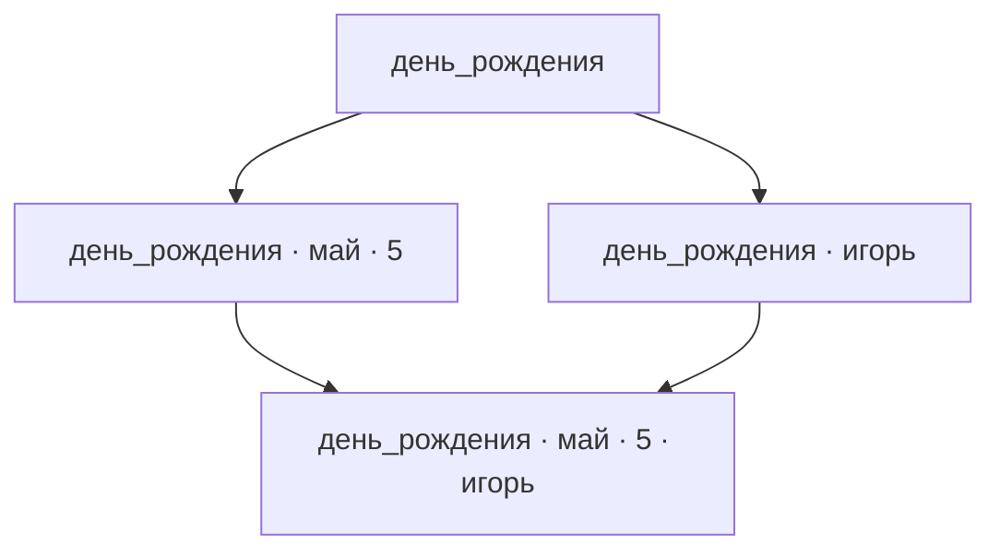

# Идея продукта

## 1. Назначение продукта

Продукт помогает быстро находить нужные записи — тексты, изображения, аудиозаписи, видеозаписи и другие материалы. Такие записи называются **элементами**.

Для отбора элементов используются **теги** — обозначения, назначаемые элементам. Пользователь выбирает нужные теги при поиске.

Главный принцип представления — в каждый момент времени показывать пользователю по возможности наиболее обозримый результат из элементов, максимально релевантных выбранным пользователем тегам.

## 2. Элементы, теги и рабочая область

**Рабочая область** — совокупность элементов, организованных с помощью тегов.

**Текущий набор тегов рабочей области** — теги, доступные в ней для разметки элементов и навигации.

**Базовый глоссарий тегов** — текущий набор тегов рабочей области вместе с необязательными поясняющими описаниями этих тегов.

**Содержание элемента** — текст, изображение, аудиозапись, видеозапись или другое содержимое, отдельное от тегов элемента.

**Теговая разметка элемента** — полный набор тегов, назначенных элементу в данной рабочей области. **Разметка** — назначение элементу тегов из текущего набора тегов рабочей области.

**Базовая функциональность** — обязательный набор возможностей продукта.

**Необязательные расширения** — дополнения к базовой функциональности продукта.

Пользователь может начать с пустого или небольшого набора тегов. Когда при разметке встречается тег, которого ещё нет в текущем наборе рабочей области, продукт добавляет его в этот набор. Для каждого нового тега пользователю предлагается задать поясняющее описание его смысла. Тег становится доступным для использования независимо от наличия описания. Добавленные теги сохраняются в наборе, даже если не назначены ни одному элементу.

Так при разметке элементов постепенно формируется базовый глоссарий тегов рабочей области.

В базовой функциональности теги назначаются пользователем вручную.

**Название элемента** — необязательное свойство, помогающее пользователю узнать элемент при просмотре. Название отделено от содержания и теговой разметки. Разные элементы могут иметь одинаковые названия, в том числе при одинаковой теговой разметке.

При изменении названия или теговой разметки элемент считается тем же, если содержание не меняется. При изменении содержания результат считается другим элементом и заменяет исходную запись в рабочей области.

В базовой функциональности элемент может содержать материал одного вида или иметь пустое содержание. Например, запись с тегами `игорь артемьев май день_рождения 5` может иметь пустое содержание. Теги позволяют понять, о каком факте идёт речь, и остаются тегами, отдельными от содержания записи.

Текстовые элементы должны быть обозримыми: обычно не более одного абзаца, максимум несколько абзацев. Примеры таких элементов — анекдоты, афоризмы, тосты, стихи и заметки разного характера.

Типовые аудио- и видеоэлементы — песни, ролики и рассказанные анекдоты. Их продолжительность, как правило, не превышает пяти минут.

Каждая операция разметки отдельного элемента **атомарна**: она выполняется как единое неделимое действие. Разметку одного и того же элемента можно выполнять повторно, в том числе для приведения разметки в соответствие содержимому.

**Размеченный элемент** — элемент, для которого задана теговая разметка в данной рабочей области.

**Неразмеченный элемент** — элемент, для которого такая разметка ещё не задана.

Заданная разметка может быть пустым набором тегов. Пользователь может в любой момент изменить разметку, сохраняя соответствие тегов содержанию элемента.

## 3. Узлы и выборки

**Теговая выборка** — совокупность всех размеченных элементов рабочей области, которым назначены все теги выбранного набора.

Для организации элементов и навигации продукт использует граф наборов тегов рабочей области. Рёбра отражают включение одних наборов тегов в другие.

**Узел** — вершина графа продукта, соответствующая уникальному набору тегов из числа доступных в рабочей области.

**Выборка узла** — теговая выборка, заданная набором тегов этого узла.

Узлы различаются по задающим их тегам. Два разных узла могут иметь одинаковые по составу выборки.

Пользователь может выбрать для отбора элементов любые теги из текущего набора тегов рабочей области. Эти теги называются **выбранными тегами**, узел с этим набором — **текущим узлом**, а его выборка — **текущей выборкой**.

**Собственный элемент узла** — размеченный элемент, теговая разметка которого полностью совпадает с набором тегов узла. Выражение «элемент принадлежит узлу» обозначает это точное совпадение.

**Заполненный узел** — узел, имеющий хотя бы один собственный элемент.

**Незаполненный узел** — узел, не имеющий собственных элементов. Команда удаления незаполненного узла не предусмотрена.

**Непустая выборка** — выборка, содержащая хотя бы один элемент.

**Корень (корневой узел)** — узел с пустым набором тегов. Его выборка включает все размеченные элементы рабочей области.

При изменении выбранных тегов:

- Добавление тегов сужает выборку.
- Удаление тегов расширяет выборку.

Например, пусть существует только одна запись с разметкой `день_рождения май 5`:

| Узел | Собственные элементы | Выборка |
| --- | --- | --- |
| `день_рождения` | Нет | Содержит запись |
| `день_рождения май` | Нет | Содержит запись |
| `день_рождения май 5` | Эта запись | Содержит запись |

В этом примере заполнен только последний узел, а выборки всех трёх узлов непусты.

## 4. Иерархия и связи между узлами

Узлы образуют иерархию по включению наборов тегов.

**Потомок узла** — узел, имеющий все теги исходного узла и хотя бы один дополнительный тег.

**Предок узла** — узел, набор тегов которого строго включён в набор тегов исходного узла.

**Промежуточный узел** между предком и потомком — узел, имеющий все теги предка и непустую часть дополнительных тегов потомка, но не все эти дополнительные теги.

Если набор тегов одного узла строго входит в набор другого, выборка первого включает выборку второго.

Выборка узла включает его собственные элементы и собственные элементы всех его потомков.

Таким образом, у узла может не быть собственных элементов, хотя его выборка непуста за счёт потомков.

Иерархия узлов образует направленный ациклический граф (DAG).

### DAG всех наборов тегов

Если текущий набор тегов рабочей области содержит n тегов, полный DAG содержит 2ⁿ узлов, включая корень с пустым набором тегов. Ребро соответствует добавлению одного тега.

Цикл невозможен: движение по направлению рёбер каждый раз увеличивает набор тегов. В один узел могут входить несколько рёбер, и из него могут выходить несколько рёбер.

### Виды близости

Различаются три понятия близости:

| Понятие | Определение |
| --- | --- |
| Соседние узлы | Два узла, один из которых получается из другого добавлением или удалением одного тега. Заполненность не обязательна. |
| Ближайшие заполненные узлы | Заполненные предки и потомки текущего узла, чьи наборы тегов получаются из текущего набора наименьшим числом добавлений либо удалений тегов. |
| Соседние заполненные узлы | Заполненные предки и потомки текущего узла, между которыми и текущим нет других заполненных узлов. |

### Граф соседства заполненных узлов

**Граф соседства заполненных узлов** — граф, вершинами которого служат заполненные узлы, а рёбра связывают соседние заполненные узлы. Рёбра направлены от меньшего набора тегов к большему. Такое представление порядка называется диаграммой Хассе.

Граф соседства заполненных узлов служит для навигации между ними, позволяя пропускать промежуточные незаполненные узлы.

Одно ребро графа соседства заполненных узлов может соответствовать добавлению нескольких тегов. Поэтому число рёбер и число изменяемых тегов — разные величины. При построении графа соседства на основе DAG всех наборов тегов связи между заполненными узлами определяются заново.

Например, пусть заполнены только четыре следующих узла:

Узлы `день_рождения май 5` и `день_рождения` — соседние заполненные узлы, хотя ребро между ними соответствует добавлению двух тегов. В узел с четырьмя тегами входят два ребра.

## 5. Навигация

**Переход к узлу** — действие, в результате которого выбранный узел становится текущим. Выбранные теги, выборка и предлагаемые переходы обновляются в соответствии с этим узлом.

Пользователь может перейти из любого узла в любой другой, задав его набор тегов. Заполненность исходного узла и узла назначения не ограничивает возможность перехода.

Для любого текущего узла, в том числе незаполненного, продукт предлагает переходы к его соседним заполненным предкам и потомкам, если они есть.

Пользователь может двигаться по рёбрам в обе стороны: по их направлению — добавляя теги и сужая выборку, против их направления — удаляя теги и расширяя её.

Навигационный приоритет заполненных узлов соответствует их близости к текущему узлу: **чем меньше тегов нужно добавить или удалить для перехода, тем выше приоритет**.

Для перехода к соседнему заполненному узлу может потребоваться добавить в набор выбранных тегов или удалить из него сразу несколько тегов. Например, пусть для перехода к соседнему заполненному потомку нужно добавить два тега, а для перехода к соседнему заполненному предку — удалить четыре. В этом случае потомок имеет более высокий навигационный приоритет, поскольку переход к нему требует изменения меньшего числа тегов.

При первом открытии рабочей области текущим становится корень. При повторном открытии восстанавливается последний посещённый узел.

Из любого узла пользователь может перейти в корень одним действием — например, нажатием отдельной кнопки. При таком переходе снимаются все выбранные теги.

### Симметрия направлений

**Родительский и дочерний узлы** — узлы, соединённые одним направленным ребром: от родительского к дочернему.

В древовидной иерархии у корня нет родителя, а у каждого другого узла ровно один родитель. Дочерних узлов может быть несколько. В DAG у узла могут быть несколько родителей и несколько дочерних узлов. Из разных родительских узлов можно открыть один и тот же узел с одними и теми же собственными элементами.

В навигации по заполненным узлам направления «вверх» ведут к соседним заполненным предкам, направления «вниз» — к соседним заполненным потомкам. В обоих направлениях переход может изменять несколько тегов.

Симметрия направлений используется там, где она помогает пользователю ориентироваться и получать обозримый, релевантный результат. Способы представления предков и потомков выбираются по их полезности для пользователя.

### Обозначения узла и переходов

Текущий узел обозначается полным набором тегов. Переходы к соседним заполненным узлам обозначаются изменением этого набора: знаком `+` и добавляемыми тегами либо знаком `−` и удаляемыми тегами. В обозначении перечисляются все изменяемые при переходе теги.

Например, из узла `ремонт кухня`:

| Узел назначения | Обозначение перехода |
| --- | --- |
| `ремонт кухня электрика` | `+ электрика` |
| `ремонт` | `− кухня` |
| `кухня` | `− ремонт` |

### Предлагаемые переходы

**Набор предлагаемых переходов** — варианты сужения и расширения выборки.

По умолчанию показывается компактный набор наиболее приоритетных переходов. Остальные доступны по запросу. Этот принцип применяется к переходам как к предкам, так и к потомкам. Постраничный просмотр может использоваться только для переходов к потомкам.

### Сведения об узлах

При представлении соседних заполненных узлов общее количество элементов выборки отражается всегда. Количество собственных элементов узла отражается в зависимости от настроек пользователя.

Числовое обозначение этих показателей необязательно: количество может передаваться стилистически — например, интенсивностью цвета, размером шрифта или их сочетанием. Стилистическое обозначение также может сочетаться с числовым.

### История переходов

Продукт поддерживает навигацию назад и вперёд по истории посещённых узлов, аналогично истории веб-браузера. В историю входят переходы как при изменении выбранных тегов, так и при выборе предлагаемых узлов.

- **Назад** — переход к предыдущему узлу в истории.
- **Вперёд** — переход к следующему узлу в истории после возврата назад.

Если после возврата назад пользователь совершает новый переход, изменяя выбранные теги или выбирая предлагаемый узел, прежнее продолжение истории заменяется этим переходом. Движение назад и вперёд по самой истории новых записей в неё не добавляет.

## 6. Просмотр узла

Ментальная модель иерархии узлов опирается на аналогию с папками и файлами.

По умолчанию пользователь видит собственные элементы текущего узла и набор предлагаемых переходов к его соседним заполненным предкам и потомкам. Собственные элементы аналогичны файлам в открытой папке, а переходы к потомкам — подпапкам. В этом режиме для просмотра собственных элементов другого узла пользователь переходит в него.

После удаления последнего собственного элемента или изменения его разметки пользователь остаётся в текущем узле с прежними выбранными тегами.

В режиме просмотра собственных элементов для незаполненного текущего узла различаются два состояния:

| Состояние | Представление |
| --- | --- |
| Собственных элементов нет, но есть заполненные потомки | Обозначение отсутствия собственных элементов. |
| Нет ни собственных элементов, ни заполненных потомков | Сообщение об отсутствии элементов с выбранными тегами. |

В обоих состояниях пользователь видит теги текущего узла и может изменять их, переходя в другие узлы независимо от их заполненности. Также доступны история переходов, выход в корень и добавление элемента.

Пользователь может переключаться между просмотром собственных элементов и просмотром выборки узла, не меняя выбранных тегов. При просмотре выборки узла собственные элементы текущего узла должны визуально выделяться среди элементов потомков.

Пользователь может быстро переключаться между сортировкой элементов по времени последнего изменения и по названию. По умолчанию сначала показываются наиболее недавно изменившиеся элементы.

При сортировке по названию элементы без названия располагаются в конце. Элементы с одинаковыми названиями упорядочиваются по времени последнего изменения: недавно изменившиеся — первыми.

Для нового элемента время последнего изменения — это время его добавления в рабочую область. Изменение названия или теговой разметки обновляет это время.

Выбранные режим просмотра и сортировка сохраняются при переходах между узлами, включая изменение выбранных тегов, переходы назад и вперёд по истории и выход в корень.

При изменении заполненности узлов предлагаемые переходы сразу обновляются в соответствии с новым соседством. Текущий узел и выбранный режим просмотра сохраняются.

Например, при просмотре выборки узла пользователь вводит имя знакомого и получает записи, которым назначен этот тег. Если записей слишком много, он добавляет фамилию и ищет среди оставшихся запись о дне рождения. Обратный сценарий — задать дату и найти записи о людях, у которых на неё приходится день рождения.

## 7. Помощь при вводе тегов

**Автодополнение** — предложение подходящих тегов по мере их набора. Оно работает начиная с первого тега и помогает выбирать каждый следующий тег.

После выбора тегов подсказки для следующего ограничиваются тегами, встречающимися в элементах текущей выборки.

## 8. Работа с элементами

### Режим разметки

**Переразметка** — повторное назначение тегов элементу в рабочей области.

Продукт должен поддерживать **возобновляемую разметку** — разметку, которую можно приостановить и продолжить позже с сохранением выполненной работы.

По мере разметки элементы начинают участвовать в выборках, не дожидаясь разметки остальных элементов.

Неразмеченные элементы доступны в отдельном списке независимо от текущей выборки. Работа с ними выполняется в отдельном режиме разметки.

Прогресс процесса разметки должен обозначаться визуально.

Доступность и отображение исходной теговой разметки во время переразметки определяются настройками. После завершения переразметки каждого элемента его исходная разметка не сохраняется.

### Создание, редактирование и удаление

В типовом сценарии пользователь постепенно наполняет рабочую область, добавляя запись за записью.

При создании нового элемента теги текущего узла автоматически предлагаются в качестве начальной разметки. Пользователь может оставить их, дополнить или изменить.

Пользователь может быстро сохранить новый элемент без разметки. Элемент попадает в список неразмеченных для последующей разметки.

Редактирование элемента доступно из любого представления, в котором пользователь может просматривать этот элемент, независимо от текущего узла и принадлежности элемента узлу.

За соответствие тегов содержанию отвечает тот, кто изменяет содержание или разметку.

При редактировании содержания пользователь видит текущие теги. При изменении тегов ему доступно содержание элемента для чтения, просмотра или воспроизведения.

Перед сохранением изменённого содержания продукт напоминает пользователю, что теги должны соответствовать новому содержанию. Напоминание включено по умолчанию и может быть отключено в настройках.

После сохранения созданного или отредактированного элемента пользователь остаётся в текущем узле. Если элемент размечен и принадлежит другому узлу, продукт показывает этот узел и предлагает перейти в него. Переход выполняется по выбору пользователя.

Элемент можно окончательно удалить из рабочей области.

### Перемещение элемента

**Перемещение элемента** — изменение его разметки в пределах рабочей области на полный набор тегов узла назначения.

Перемещение требует соответствия новых тегов содержанию элемента. Продукт предоставляет пользователю содержание и новые теги для проверки их соответствия и позволяет при необходимости скорректировать содержание. Если обеспечить соответствие невозможно, перемещение не выполняется.

## 9. Базовая функциональность

| Направление | Возможности |
| --- | --- |
| Рабочие области | Работа с элементами разных типов и текущим набором тегов рабочей области. Новые теги при разметке добавляются в этот набор; для каждого предлагается задать поясняющее описание. Так формируется базовый глоссарий тегов. |
| Наполнение и разметка | Постепенное добавление элементов, быстрое сохранение без разметки, ручная разметка и переразметка. Отдельный список неразмеченных элементов, возобновляемая разметка и визуальное обозначение её прогресса. |
| Редактирование, перемещение и удаление | Редактирование содержания и перемещение элементов между узлами с поддержкой соответствия содержания и тегов. Окончательное удаление элементов из рабочей области. |
| Теговые выборки | Быстрый отбор элементов по всем выбранным тегам и автодополнение при вводе тегов. |
| Навигация | Сужение и расширение выборки добавлением и удалением тегов. Набор предлагаемых переходов к соседним заполненным узлам с приоритетом по близости, история назад и вперёд, выход в корень одним действием. |
| Просмотр | По умолчанию — собственные элементы узла и набор предлагаемых переходов к соседним заполненным предкам и потомкам. Возможность просмотра выборки узла с выделением собственных элементов. Сортировка по времени последнего изменения или по названию, по умолчанию — недавно изменившиеся первыми. Выбранные режим просмотра и сортировка сохраняются при переходах. |

## 10. Соглашения с расширениями

### Подключение

Базовая функциональность доступна без расширений. Подключение расширения добавляет описанные в его документе возможности и не делает базовую функциональность зависимой от него.

Совместные сценарии независимых расширений координирует родительский модуль продукта.

### Общая модель и взаимодействие

Расширения используют определения элементов, текущего набора тегов рабочей области, базового глоссария, разметки, узлов и выборок из этого документа. Они дополняют возможности продукта, сохраняя смысл этих понятий и общие правила работы с ними.

| Область взаимодействия | Соглашение |
| --- | --- |
| Работа с элементами | Создание и изменение элементов подчиняются правилам разделов 2 и 8. Правила сохранения того же элемента, соответствия тегов содержанию и обновления времени последнего изменения применяются независимо от того, выполняет действие пользователь или расширение. |
| Разметка | При работе с разметкой расширение использует её состояния и отдельный список неразмеченных элементов базового продукта. Атомарность разметки одного элемента, возобновляемость работы, визуальное обозначение прогресса и правила обращения с исходной разметкой сохраняются при добавлении новых способов разметки. |
| Участие в выборках | Элементы, с которыми работает расширение, участвуют в выборках, если они размечены и их разметка содержит все выбранные теги. Дополнительные способы поиска не меняют определения теговой выборки. |
| Отображение изменений | Изменение элементов и разметки учитывается при просмотре, сортировке и определении соседства узлов по правилам разделов 5 и 6. |

### Документы расширений

| Необязательное расширение | Обязательная зависимость |
| --- | --- |
| [Самостоятельные глоссарии тегов](extensions/TAG_GLOSSARY.md) | Базовый продукт и текущий набор тегов рабочей области. |
| [Импорт и экспорт](extensions/IMPORT_EXPORT.md) | Базовый продукт, включая ручную возобновляемую разметку. |
| [Автоматическая разметка с помощью большой языковой модели (LLM)](extensions/LLM_ANNOTATION.md) | Базовый продукт и его правила разметки. |
| [Поиск по тексту внутри текущей выборки](extensions/TEXT_SEARCH.md) | Базовый продукт и текущая теговая выборка. |

[Сочетание разных видов содержания](extensions/MIXED_CONTENT.md) рассматривается как потенциальное расширение. Его правила требуют отдельного определения.

[Справочник терминов проекта](GLOSSARY.md) содержит определения общих понятий базовой модели.

### Координация работы с самостоятельными глоссариями тегов

Расширение [«Самостоятельные глоссарии тегов»](extensions/TAG_GLOSSARY.md) позволяет создавать и выбирать наборы тегов для использования в разных рабочих областях. Они существуют как самостоятельные глоссарии. Базовый глоссарий формируется в конкретной рабочей области и доступен без расширения. При использовании расширения родительский модуль обеспечивает применение тегов выбранного самостоятельного глоссария в текущем наборе тегов рабочей области.

Разметка и навигация базового продукта работают с текущим набором тегов. Автоматическая разметка также использует этот набор независимо от способа его формирования; сведения о расширении самостоятельных глоссариев ей не требуются.

Правила применения выбранного самостоятельного глоссария к уже существующему базовому глоссарию и размеченным элементам требуют отдельного определения.

### Координация импорта, экспорта и самостоятельных глоссариев

При совместном использовании расширений импорта и экспорта и самостоятельных глоссариев родительский модуль поддерживает перенос всей рабочей области или её части с самостоятельным глоссарием либо без него. При экспорте части рабочей области пользователь может включить самостоятельный глоссарий полностью — со всеми его тегами — или в сокращённом составе, содержащем только его теги, использованные в экспортируемых элементах. Правила различения таких глоссариев определены в расширении «Самостоятельные глоссарии тегов».

Если принимающая рабочая область использует самостоятельный глоссарий через расширение, к новым для неё элементам применяются следующие правила:

| Самостоятельный глоссарий в передаваемых данных | Переразметка новых элементов |
| --- | --- |
| Тот же, что используется принимающей областью | По желанию пользователя: сохранить исходную разметку или выполнить переразметку. |
| Другой | Обязательна для всех новых элементов. |
| Отсутствует | Обязательна для всех новых элементов. |

При сохранении исходной разметки сохраняется и её состояние: неразмеченный элемент остаётся неразмеченным, а размеченный элемент с пустым набором тегов — собственным элементом корня. При переразметке должны использоваться теги самостоятельного глоссария, выбранного в принимающей области. Согласование этого требования с текущим набором, содержащим теги вне выбранного самостоятельного глоссария, требует отдельного определения.

Сравниваются самостоятельные глоссарии, используемые в данный момент; история их изменения не учитывается. При переносе с сокращённым самостоятельным глоссарием в область с полным исходным самостоятельным глоссарием переразметка всех новых элементов обязательна.

Эти правила действуют для переноса как всей рабочей области, так и её части. Для уже имеющихся элементов сохраняются правила повторного импорта. Отсутствие самостоятельного глоссария в передаваемых данных отличается от случая, когда принимающая область использует только базовый глоссарий: правила разметки новых элементов во втором случае требуют отдельного определения.

### Координация импорта и автоматической разметки

Импорт и автоматическая разметка — независимые расширения. Необходимость переразметки определяется правилами импорта. Элементы, которым требуется разметка, поступают в общий список неразмеченных базового продукта.

При наличии обоих расширений родительский модуль может использовать автоматическую разметку для работы с такими элементами. Автоматическая разметка работает с элементами и текущим набором тегов рабочей области независимо от происхождения элементов; сведения об импорте и его правилах ей не требуются.

Координация сохраняет правила импорта: разметка уже имеющихся элементов и различия названий обрабатываются по правилам расширения импорта и экспорта. Выбор фонового способа разметки не меняет этих правил. Ручная разметка остаётся доступной независимо от наличия расширения автоматической разметки.

## 11. Открытые вопросы

- Какие изменения текущего набора тегов рабочей области, помимо добавления новых тегов, следует поддерживать?
- Какие правила могут определять подбор направлений навигации через замену тегов, в том числе к узлам с тем же числом тегов?
- Стоит ли предоставлять пользователю возможность ручной группировки через промежуточные узлы без собственных элементов, и как она должна работать?

[Правила организации документации](DOCUMENTATION_RULES.md).
